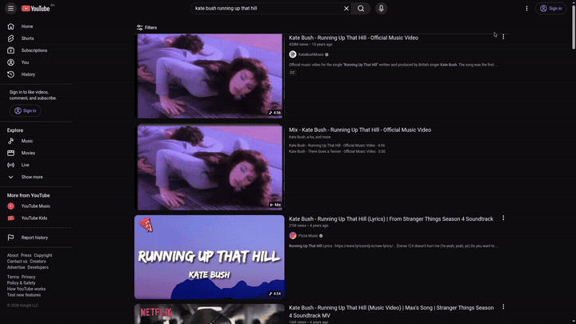

# tg-media-bot

[](https://github.com/antlis/tg-media-bot/actions/workflows/ci.yml)
[](LICENSE)

**🌐 [Website & overview](https://antlis.is-a.dev/tg-media-bot/)**

[**English**](README.md) · [Русский](docs/README.ru.md) · [Українська](docs/README.uk.md) · [Español](docs/README.es.md)



A fast, lightweight and reliable self-hosted Telegram bot written in **Rust** that downloads video and audio from social networks and video hosting sites and sends it straight back into the chat.

The bot is built for maximum performance and minimal resource use: it idles at around **4.5 MB RAM**, strictly supervises child processes, protects the server from overload and OOM, and supports sending files up to **2 GB**.

---

## Features

- ⚡ **High speed, low memory** — Rust core with an async runtime. The bot stays stable even on the cheapest VPS plans.
- 📦 **Files up to 2 GB** — a bundled local Telegram Bot API server bypasses the standard 50 MB limit, so heavy videos arrive in full quality.
- 🎯 **Quality picker** — interactive buttons whenever you send a link (max, 1080p, 720p, 480p, 360p, or audio-only). Pin a default with `/quality`.
- 🚀 **Smart cache (instant delivery)** — previously downloaded media is resent instantly by `file_id`, with no re-download. Links are normalized (YouTube Shorts, X/Twitter posts, …) so duplicates are detected before a download even starts.
- 🧹 **Clean chat** — service messages ("Downloading…"), the quality menu and the original link message are deleted after a successful upload; the source link and title stay in the file caption.
- 👥 **Fair queueing** — a personal queue per user, so one spammer can't lock everyone else out.
- 🌐 **Multilingual** — Russian, Ukrainian, English and Spanish, auto-detected from the Telegram client and switchable via `/lang`.
- 🛡️ **Security** — user allowlist (`ALLOWED_USERS`), SSRF protection (requests to private networks and `localhost` are blocked).

---

## Supported sites

Thanks to the `yt-dlp` engine the bot supports **1000+ services**, including:

- **YouTube** (videos, Shorts, playlists, YouTube Music)
- **TikTok** (video and sound)
- **Instagram** (Reels, posts, stories)
- **X (Twitter)** (video and GIFs)
- **Reddit** (video with sound)
- **VK & Rutube**
- **Twitch** (clips and VODs)
- **Vimeo, SoundCloud, Pinterest** and many more

*If a site isn't supported by yt-dlp, the bot can be extended with external plugins.*

---

## Quick start on a VPS (Docker)

Any server running Linux (Ubuntu / Debian) is fine.

### Install in 5 steps

1. **Connect to your server over SSH:**
   ```bash
   ssh root@your.server.ip
   ```

2. **Install Docker** (if not installed yet):
   ```bash
   curl -fsSL https://get.docker.com | sh
   ```

3. **Create a bot directory and download the configs:**
   ```bash
   mkdir -p tg-media-bot && cd tg-media-bot
   curl -fSL https://raw.githubusercontent.com/antlis/tg-media-bot/master/docker-compose.yml -o docker-compose.yml
   curl -fSL https://raw.githubusercontent.com/antlis/tg-media-bot/master/.env.example -o .env
   ```

4. **Fill in `.env`:**
   ```bash
   nano .env
   ```
   Minimum required settings:
   - `BOT_TOKEN` — bot token from [@BotFather](https://t.me/BotFather).
   - `ALLOWED_USERS` — your Telegram ID(s), comma-separated (find yours via [@userinfobot](https://t.me/userinfobot)), so only you or your friends can use the bot. Leave empty to open access to everyone.
   - `TELEGRAM_API_ID` and `TELEGRAM_API_HASH` — from [my.telegram.org/apps](https://my.telegram.org/apps). Needed for uploads up to **2 GB** via the local Bot API server.

   > 💡 **Simplified run without API ID/Hash (50 MB file limit):**
   > If you don't need files larger than 50 MB, remove the `telegram-bot-api` service and the `API_SERVER_URL` / `LOCAL_API_SHARED_FILES` lines from `docker-compose.yml`. Only `BOT_TOKEN` and `ALLOWED_USERS` are required then.

5. **Start the bot:**
   ```bash
   docker compose up -d
   docker compose logs -f bot
   ```

### Alternative ways to run

<details>
<summary><b>Build locally from source (Docker)</b></summary>

```bash
git clone https://github.com/antlis/tg-media-bot.git
cd tg-media-bot
cp .env.example .env
nano .env
docker compose up -d --build
docker compose logs -f bot
```
</details>

<details>
<summary><b>Run without Docker (systemd)</b></summary>

Requires `yt-dlp`, `ffmpeg`, `ffprobe` on `PATH`, plus `deno` for YouTube:

```bash
cargo build --release
sudo install -m755 target/release/tg-media-bot /usr/local/bin/
sudo install -Dm600 .env /etc/tg-media-bot/env
sudo cp packaging/tg-media-bot.service /etc/systemd/system/
sudo systemctl daemon-reload && sudo systemctl enable --now tg-media-bot
```
</details>

<details>
<summary><b>Install with Nix</b></summary>

```bash
nix run github:antlis/tg-media-bot        # BOT_TOKEN etc. come from the environment
nix develop                              # dev shell: cargo + yt-dlp + ffmpeg + deno
```

For home-manager, import `homeManagerModules.default` and enable
`services.tg-media-bot` — it runs a user service, keeps state under
`~/.local/state/tg-media-bot`, and reads `BOT_TOKEN` from `environmentFile`
(extra env vars go in `settings`). Don't run the Nix bot and the Docker `bot`
container on the same token at once — they'd poll the same token.
</details>


---

## Updating the bot

If the bot runs via **Docker Compose** (the standard way):

```bash
cd tg-media-bot
docker compose pull && docker compose up -d
```

> *Note: the `yt-dlp` engine inside the container also updates itself automatically once a day (when no downloads are active).*

<details>
<summary><b>When installed from source</b></summary>

**Docker (local build):**
```bash
cd tg-media-bot
git pull
docker compose up -d --build
```

**systemd:**
```bash
cd tg-media-bot
git pull
cargo build --release
sudo install -m755 target/release/tg-media-bot /usr/local/bin/
sudo systemctl restart tg-media-bot
```

**Nix:**
```bash
nix run github:antlis/tg-media-bot   # flakes pin nixpkgs; `nix flake update` bumps them
```

</details>

---

## Bot commands

| Command | Description |
|---|---|
| *a media link* | The bot offers a quality choice and queues the download |
| `/start`, `/lang` | Pick the interface language (RU, UK, EN, ES) |
| `/help` | Overview of features and the server's current limits |
| `/quality` | Pin a default quality (or go back to asking per message) |
| `/formats <link>` | Force a quality choice (even if a default is saved) |
| `/status` | Your queue state and active download IDs |
| `/cancel [id]` / `/cancel all` | Cancel one download or your whole queue |
| `/clear [n]` | Delete the bot's last `n` messages in the chat (default 100) |
| `/minimal on\|off` | Minimalist mode (no progress statuses or verbose captions) |
| `/topic lock\|unlock\|status` | Restrict the bot to one forum topic in a supergroup |
| `/stats`, `/admin` | CPU, memory, disk and queue monitoring *(admins only)* |
| `/cleancache` | Force-clear the saved `file_id` cache *(admins only)* |
| `/broadcast <text>` | Send a system message to all active chats *(admins only)* |

### Groups

When an allowed user (`ALLOWED_USERS`) messages the bot in a group, the group is activated and all its members can use the bot. So the bot reacts to plain links without an `@` mention, turn off **Group Privacy** in the bot's settings via [@BotFather](https://t.me/BotFather).

---

## Main configuration (`.env`)

Detailed comments for every option live in [.env.example](.env.example).

| Variable | Default | Description |
|---|---|---|
| `BOT_TOKEN` | — | Telegram bot token |
| `ALLOWED_USERS` | — | Comma-separated user IDs with access |
| `ADMIN_USERS` | — | Bot admin IDs (stats, broadcast) |
| `MAX_PARALLEL_DOWNLOADS` | `1` | Simultaneous downloads for the whole bot |
| `USER_QUEUE_SIZE` | `100` | Max personal queue size per user |
| `RATE_LIMIT_PER_USER` | `1` | How many of one user's links download at once |
| `MAX_QUEUE_SIZE` | `1000` | Max size of the shared bot-wide queue |
| `MAX_FILE_SIZE_MB` | API limit | Largest file to send (quality is stepped down to fit) |
| `MAX_DURATION_MIN` | `180` | Longest media duration in minutes (0 — no limit) |
| `MAX_HEIGHT` | `1080` | Max video height (1080p, 720p, …) |
| `MIN_FREE_DISK_MB` | `300` | Minimum free disk before a download may start |
| `CHILD_NICE` | `10` | `yt-dlp`/`ffmpeg` process priority (0 — normal, 19 — lowest) |
| `BLOCK_PRIVATE_URLS` | `true` | Block links to private networks and `localhost` |
| `PROXY_URL` | — | Proxy for bypassing regional blocks (SOCKS5 / HTTP) |

---

## Auth & cookies

To download from private accounts or services that require login (e.g. Instagram or age-restricted YouTube):

1. Export cookies in Netscape format (`cookies.txt`) with a browser extension (e.g. *Get cookies.txt LOCALLY*).
2. Put the file at `./cookies/cookies.txt` next to `docker-compose.yml`.
3. The container picks it up on the next download.

---

## Plugins for unsupported sites

If you need media from a site `yt-dlp` doesn't support, drop an executable script into `./plugins`:

- A plugin can be written in any language (Python, Bash, Node.js, Go, …).
- It receives the link as its first CLI argument and prints a direct stream URL or JSON with headers.
- See [examples/plugin-example.py](examples/plugin-example.py).

---

## Testing & diagnostics

You can test extraction and download right from the container console, without touching Telegram:

```bash
docker compose run --rm bot fetch "https://youtu.be/..."        # video
docker compose run --rm bot fetch "https://youtu.be/..." audio   # audio
docker compose run --rm bot fetch "https://youtu.be/..." 480     # resolution cap
```

---

## License

Released under the [MIT](LICENSE) license.