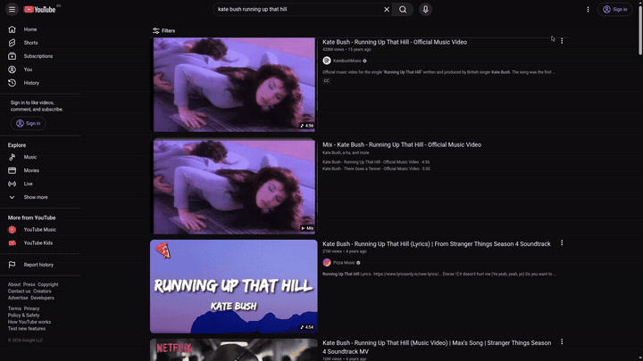

# tg-media-bot

[](https://github.com/antlis/tg-media-bot/actions/workflows/ci.yml)
[](LICENSE)

**🌐 [Sitio web y descripción](https://antlis.is-a.dev/tg-media-bot/)**

[English](../README.md) · [Русский](README.ru.md) · [Українська](README.uk.md) · [**Español**](README.es.md)



Un bot de Telegram autohospedado, rápido y ligero, escrito en **Rust**, que descarga vídeo y audio de redes sociales y plataformas de vídeo y los envía directamente al chat.

El bot está diseñado para el máximo rendimiento y el mínimo consumo de recursos: consume unos **4,5 MB de RAM** en reposo, supervisa estrictamente los procesos hijos, protege el servidor de sobrecargas y OOM, y permite enviar archivos de hasta **2 GB**.

---

## Características

- ⚡ **Alta velocidad, bajo consumo de memoria** — núcleo en Rust con runtime asíncrono. El bot se mantiene estable incluso en los VPS más baratos.
- 📦 **Archivos de hasta 2 GB** — un servidor local de Telegram Bot API integrado evita el límite estándar de 50 MB, y los vídeos pesados llegan en plena calidad.
- 🎯 **Selector de calidad** — botones interactivos al enviar un enlace (máximo, 1080p, 720p, 480p, 360p o solo audio). Fija una opción por defecto con `/quality`.
- 🚀 **Caché inteligente (entrega instantánea)** — los medios descargados antes se reenvían al instante por `file_id`, sin redescargar. Los enlaces se normalizan (YouTube Shorts, publicaciones de X/Twitter, …) y los duplicados se detectan antes de iniciar la descarga.
- 🧹 **Chat limpio** — los mensajes de servicio («Descargando…»), el menú de calidad y el mensaje original con el enlace se eliminan tras un envío correcto; el enlace de origen y el título quedan en la descripción del archivo.
- 👥 **Cola justa** — una cola personal por usuario, para que un spammer no bloquee al resto.
- 🌐 **Multilingüe** — ruso, ucraniano, inglés y español, detectados automáticamente del cliente de Telegram y cambiables con `/lang`.
- 🛡️ **Seguridad** — lista blanca de usuarios (`ALLOWED_USERS`), protección SSRF (las peticiones a redes privadas y `localhost` se bloquean).

---

## Sitios soportados

Gracias al motor `yt-dlp` el bot soporta **más de 1000 servicios**, incluidos:

- **YouTube** (vídeos, Shorts, listas de reproducción, YouTube Music)
- **TikTok** (vídeo y sonido)
- **Instagram** (Reels, publicaciones, historias)
- **X (Twitter)** (vídeo y GIF)
- **Reddit** (vídeo con sonido)
- **VK y Rutube**
- **Twitch** (clips y VOD)
- **Vimeo, SoundCloud, Pinterest** y muchos más

*Si un sitio no está soportado por yt-dlp, el bot se puede ampliar con plugins externos.*

---

## Inicio rápido en un VPS (Docker)

Sirve cualquier servidor con Linux (Ubuntu / Debian).

### Instalación en 5 pasos

1. **Conéctate al servidor por SSH:**
   ```bash
   ssh root@ip.de.tu.servidor
   ```

2. **Instala Docker** (si aún no está instalado):
   ```bash
   curl -fsSL https://get.docker.com | sh
   ```

3. **Crea un directorio para el bot y descarga la configuración:**
   ```bash
   mkdir -p tg-media-bot && cd tg-media-bot
   curl -fSL https://raw.githubusercontent.com/antlis/tg-media-bot/master/docker-compose.yml -o docker-compose.yml
   curl -fSL https://raw.githubusercontent.com/antlis/tg-media-bot/master/.env.example -o .env
   ```

4. **Rellena `.env`:**
   ```bash
   nano .env
   ```
   Ajustes mínimos necesarios:
   - `BOT_TOKEN` — token del bot de [@BotFather](https://t.me/BotFather).
   - `ALLOWED_USERS` — tus IDs de Telegram, separados por comas (consíguelos con [@userinfobot](https://t.me/userinfobot)), para que solo tú o tus amigos usen el bot. Déjalo vacío para abrir el acceso a todos.
   - `TELEGRAM_API_ID` y `TELEGRAM_API_HASH` — de [my.telegram.org/apps](https://my.telegram.org/apps). Necesarios para enviar archivos de hasta **2 GB** vía el Bot API local.

   > 💡 **Arranque simplificado sin API ID/Hash (límite de 50 MB):**
   > Si no necesitas archivos mayores de 50 MB, elimina del `docker-compose.yml` el servicio `telegram-bot-api` y las líneas `API_SERVER_URL` / `LOCAL_API_SHARED_FILES`. Entonces bastan `BOT_TOKEN` y `ALLOWED_USERS`.

5. **Inicia el bot:**
   ```bash
   docker compose up -d
   docker compose logs -f bot
   ```

### Formas alternativas de ejecutarlo

<details>
<summary><b>Compilar localmente desde el código (Docker)</b></summary>

```bash
git clone https://github.com/antlis/tg-media-bot.git
cd tg-media-bot
cp .env.example .env
nano .env
docker compose up -d --build
docker compose logs -f bot
```
</details>

<details>
<summary><b>Ejecutar sin Docker (systemd)</b></summary>

Requiere `yt-dlp`, `ffmpeg`, `ffprobe` en el `PATH`, además de `deno` para YouTube:

```bash
cargo build --release
sudo install -m755 target/release/tg-media-bot /usr/local/bin/
sudo install -Dm600 .env /etc/tg-media-bot/env
sudo cp packaging/tg-media-bot.service /etc/systemd/system/
sudo systemctl daemon-reload && sudo systemctl enable --now tg-media-bot
```
</details>

<details>
<summary><b>Instalar con Nix</b></summary>

```bash
nix run github:antlis/tg-media-bot        # BOT_TOKEN etc. se toman del entorno
nix develop                              # shell de desarrollo: cargo + yt-dlp + ffmpeg + deno
```

Para home-manager, importa `homeManagerModules.default` y activa
`services.tg-media-bot` — se ejecuta como servicio de usuario, guarda el
estado en `~/.local/state/tg-media-bot` y lee `BOT_TOKEN` de
`environmentFile` (variables extra van en `settings`). No ejecutes a la vez
el bot de Nix y el contenedor Docker `bot` sobre el mismo token — ambos
harían polling del mismo token.
</details>

---

## Actualizar el bot

Si el bot corre con **Docker Compose** (la forma estándar):

```bash
cd tg-media-bot
docker compose pull && docker compose up -d
```

> *Nota: el motor `yt-dlp` dentro del contenedor también se actualiza solo una vez al día (cuando no hay descargas activas).*

<details>
<summary><b>Si lo instalaste desde el código</b></summary>

**Docker (compilación local):**
```bash
cd tg-media-bot
git pull
docker compose up -d --build
```

**systemd:**
```bash
cd tg-media-bot
git pull
cargo build --release
sudo install -m755 target/release/tg-media-bot /usr/local/bin/
sudo systemctl restart tg-media-bot
```

**Nix:**
```bash
nix run github:antlis/tg-media-bot   # los flakes fijan nixpkgs; `nix flake update` los actualiza
```
</details>

---

## Comandos del bot

| Comando | Descripción |
|---|---|
| *un enlace de medios* | El bot ofrece elegir calidad y encola la descarga |
| `/start`, `/lang` | Elegir idioma de la interfaz (RU, UK, EN, ES) |
| `/help` | Resumen de funciones y límites actuales del servidor |
| `/quality` | Fijar una calidad por defecto (o volver a preguntar en cada mensaje) |
| `/formats <enlace>` | Forzar la elección de calidad (aunque haya una guardada) |
| `/status` | Estado de tu cola e IDs de descargas activas |
| `/cancel [id]` / `/cancel all` | Cancelar una descarga o toda tu cola |
| `/clear [n]` | Borrar los últimos `n` mensajes del bot en el chat (100 por defecto) |
| `/minimal on\|off` | Modo minimalista (sin estados de progreso ni descripciones largas) |
| `/topic lock\|unlock\|status` | Restringir el bot a un tema del foro en un supergrupo |
| `/stats`, `/admin` | Monitorización de CPU, memoria, disco y colas *(solo admins)* |
| `/cleancache` | Forzar el borrado de la caché de `file_id` *(solo admins)* |
| `/broadcast <texto>` | Enviar un aviso a todos los chats activos *(solo admins)* |

### Grupos

Cuando un usuario permitido (`ALLOWED_USERS`) escribe al bot en un grupo, el grupo se activa y todos sus miembros pueden usarlo. Para que el bot reaccione a enlaces sueltos sin `@`, desactiva **Group Privacy** en los ajustes del bot vía [@BotFather](https://t.me/BotFather).

---

## Configuración principal (`.env`)

Los comentarios detallados de cada opción están en [.env.example](../.env.example).

| Variable | Por defecto | Descripción |
|---|---|---|
| `BOT_TOKEN` | — | Token del bot de Telegram |
| `ALLOWED_USERS` | — | IDs de usuario con acceso (separados por comas) |
| `ADMIN_USERS` | — | IDs de administradores (estadísticas, avisos) |
| `MAX_PARALLEL_DOWNLOADS` | `1` | Descargas simultáneas de todo el bot |
| `USER_QUEUE_SIZE` | `100` | Tamaño máximo de la cola personal por usuario |
| `RATE_LIMIT_PER_USER` | `1` | Cuántos enlaces de un usuario se descargan a la vez |
| `MAX_QUEUE_SIZE` | `1000` | Tamaño máximo de la cola común del bot |
| `MAX_FILE_SIZE_MB` | límite del API | Tamaño máximo de archivo (la calidad se ajusta al límite) |
| `MAX_DURATION_MIN` | `180` | Duración máxima de vídeo en minutos (0 — sin límite) |
| `MAX_HEIGHT` | `1080` | Altura máxima de vídeo (1080p, 720p, …) |
| `MIN_FREE_DISK_MB` | `300` | Espacio libre mínimo antes de iniciar una descarga |
| `CHILD_NICE` | `10` | Prioridad de los procesos `yt-dlp`/`ffmpeg` (0 — normal, 19 — mínima) |
| `BLOCK_PRIVATE_URLS` | `true` | Bloquear enlaces a redes privadas y `localhost` |
| `PROXY_URL` | — | Proxy para saltar bloqueos regionales (SOCKS5 / HTTP) |

---

## Autenticación y cookies

Para descargar de cuentas privadas o servicios que requieren inicio de sesión (p. ej. Instagram o vídeos de YouTube con restricción de edad):

1. Exporta las cookies en formato Netscape (`cookies.txt`) con una extensión del navegador (p. ej. *Get cookies.txt LOCALLY*).
2. Coloca el archivo en `./cookies/cookies.txt` junto al `docker-compose.yml`.
3. El contenedor lo tomará automáticamente en la siguiente descarga.

---

## Plugins para sitios no soportados

Si necesitas un sitio que `yt-dlp` no soporta, añade un script ejecutable en `./plugins`:

- Un plugin puede escribirse en cualquier lenguaje (Python, Bash, Node.js, Go, …).
- Recibe el enlace como primer argumento y muestra una URL directa del stream o un JSON con cabeceras.
- Ejemplo: [examples/plugin-example.py](../examples/plugin-example.py).

---

## Pruebas y diagnóstico

Puedes probar la extracción y descarga directamente desde la consola del contenedor, sin tocar Telegram:

```bash
docker compose run --rm bot fetch "https://youtu.be/..."        # vídeo
docker compose run --rm bot fetch "https://youtu.be/..." audio   # audio
docker compose run --rm bot fetch "https://youtu.be/..." 480     # límite de resolución
```

---

## Licencia

Publicado bajo la licencia [MIT](../LICENSE).