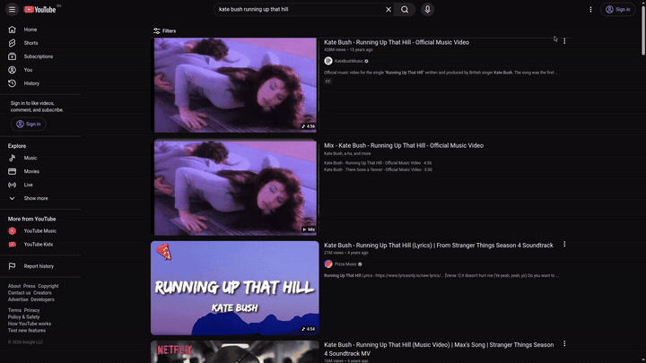

# tg-media-bot

[](https://github.com/antlis/tg-media-bot/actions/workflows/ci.yml)
[](LICENSE)

**🌐 [Сайт и обзор](https://antlis.is-a.dev/tg-media-bot/)**

[English](../README.md) · [**Русский**](README.ru.md) · [Українська](README.uk.md) · [Español](README.es.md)



Быстрый, легковесный и надежный self-hosted Telegram-бот на **Rust** для скачивания видео и аудио из социальных сетей и видеохостингов с отправкой прямо в чат Telegram.

Бот спроектирован с упором на максимальную производительность и бережное отношение к ресурсам: потребляет около **4,5 МБ RAM** в простое, строго контролирует дочерние процессы, защищает сервер от перегрузок и OOM, а также поддерживает отправку файлов размером до **2 ГБ**.

---

## Возможности

- ⚡ **Высокая скорость и низкое потребление памяти** — ядро на Rust с асинхронным рантаймом. Бот работает стабильно даже на самых дешевых VPS.
- 📦 **Файлы до 2 ГБ** — встроенный локальный сервер Telegram Bot API обходит стандартное ограничение в 50 МБ, и тяжелые видео приходят в полном качестве.
- 🎯 **Выбор качества** — интерактивные кнопки при отправке ссылки (максимум, 1080p, 720p, 480p, 360p или только аудио). Выбор можно зафиксировать командой `/quality`.
- 🚀 **Умный кэш (мгновенная отдача)** — ранее скачанные медиа отправляются мгновенно по `file_id`, без повторного скачивания. Ссылки нормализуются (YouTube Shorts, посты X/Twitter и т.д.), и дубликаты определяются до старта загрузки.
- 🧹 **Чистая лента** — сервисные сообщения («Качаем…»), меню качества и исходное сообщение со ссылкой удаляются после успешной отправки; ссылка на источник и название остаются в описании к файлу.
- 👥 **Справедливая очередь** — личная очередь для каждого пользователя, чтобы один спамер не мог заблокировать остальных.
- 🌐 **Мультиязычность** — русский, украинский, английский и испанский, автоопределение по клиенту Telegram и переключение через `/lang`.
- 🛡️ **Безопасность** — белый список пользователей (`ALLOWED_USERS`), защита от SSRF (запросы к локальным сетям и `localhost` блокируются).

---

## Поддерживаемые сайты

Благодаря движку `yt-dlp` бот поддерживает **1000+ сервисов**, включая:

- **YouTube** (видео, Shorts, плейлисты, YouTube Music)
- **TikTok** (видео и звук)
- **Instagram** (Reels, публикации, истории)
- **X (Twitter)** (видео и GIF)
- **Reddit** (видео со звуком)
- **VK и Rutube**
- **Twitch** (клипы и записи стримов)
- **Vimeo, SoundCloud, Pinterest** и многие другие

*Если сайт не поддерживается yt-dlp, бот расширяется внешними плагинами.*

---

## Быстрый старт на VPS (Docker)

Подойдет любой сервер с Linux (Ubuntu / Debian).

### Установка в 5 шагов

1. **Подключитесь к серверу по SSH:**
   ```bash
   ssh root@ip.вашего.сервера
   ```

2. **Установите Docker** (если еще не установлен):
   ```bash
   curl -fsSL https://get.docker.com | sh
   ```

3. **Создайте каталог бота и скачайте конфиги:**
   ```bash
   mkdir -p tg-media-bot && cd tg-media-bot
   curl -fSL https://raw.githubusercontent.com/antlis/tg-media-bot/master/docker-compose.yml -o docker-compose.yml
   curl -fSL https://raw.githubusercontent.com/antlis/tg-media-bot/master/.env.example -o .env
   ```

4. **Заполните `.env`:**
   ```bash
   nano .env
   ```
   Минимально необходимые параметры:
   - `BOT_TOKEN` — токен бота от [@BotFather](https://t.me/BotFather).
   - `ALLOWED_USERS` — ваши ID в Telegram через запятую (узнать в [@userinfobot](https://t.me/userinfobot)), чтобы ботом пользовались только вы и ваши друзья. Оставьте пустым — доступ открыт всем.
   - `TELEGRAM_API_ID` и `TELEGRAM_API_HASH` — с [my.telegram.org/apps](https://my.telegram.org/apps). Нужны для отправки файлов до **2 ГБ** через локальный Bot API.

   > 💡 **Упрощенный запуск без API ID/Hash (лимит файлов 50 МБ):**
   > Если файлы больше 50 МБ не нужны, удалите из `docker-compose.yml` сервис `telegram-bot-api` и строки `API_SERVER_URL` / `LOCAL_API_SHARED_FILES`. Тогда понадобятся только `BOT_TOKEN` и `ALLOWED_USERS`.

5. **Запустите бота:**
   ```bash
   docker compose up -d
   docker compose logs -f bot
   ```

### Альтернативные способы запуска

<details>
<summary><b>Локальная сборка из исходников (Docker)</b></summary>

```bash
git clone https://github.com/antlis/tg-media-bot.git
cd tg-media-bot
cp .env.example .env
nano .env
docker compose up -d --build
docker compose logs -f bot
```
</details>

<details>
<summary><b>Запуск без Docker (systemd)</b></summary>

Требуются `yt-dlp`, `ffmpeg`, `ffprobe` в `PATH`, а также `deno` для YouTube:

```bash
cargo build --release
sudo install -m755 target/release/tg-media-bot /usr/local/bin/
sudo install -Dm600 .env /etc/tg-media-bot/env
sudo cp packaging/tg-media-bot.service /etc/systemd/system/
sudo systemctl daemon-reload && sudo systemctl enable --now tg-media-bot
```
</details>

<details>
<summary><b>Установка через Nix</b></summary>

```bash
nix run github:antlis/tg-media-bot        # BOT_TOKEN и др. берутся из окружения
nix develop                              # dev-окружение: cargo + yt-dlp + ffmpeg + deno
```

Для home-manager импортируйте `homeManagerModules.default` и включите
`services.tg-media-bot` — бот запускается как пользовательский сервис, хранит
состояние в `~/.local/state/tg-media-bot` и читает `BOT_TOKEN` из
`environmentFile` (дополнительные переменные — в `settings`). Не запускайте
Nix-бота и Docker-контейнер `bot` на одном токене одновременно — они будут
поллить один и тот же токен.
</details>

---

## Обновление бота

При запуске через **Docker Compose** (стандартный способ):

```bash
cd tg-media-bot
docker compose pull && docker compose up -d
```

> *Примечание: движок `yt-dlp` внутри контейнера также обновляется автоматически раз в сутки (когда нет активных загрузок).*

<details>
<summary><b>При установке из исходников</b></summary>

**Docker (локальная сборка):**
```bash
cd tg-media-bot
git pull
docker compose up -d --build
```

**systemd:**
```bash
cd tg-media-bot
git pull
cargo build --release
sudo install -m755 target/release/tg-media-bot /usr/local/bin/
sudo systemctl restart tg-media-bot
```

**Nix:**
```bash
nix run github:antlis/tg-media-bot   # flakes фиксируют nixpkgs; `nix flake update` обновляет их
```
</details>

---

## Команды бота

| Команда | Описание |
|---|---|
| *ссылка на медиа* | Бот предложит выбрать качество и добавит задачу в очередь |
| `/start`, `/lang` | Выбор языка интерфейса (RU, UK, EN, ES) |
| `/help` | Справка по возможностям и текущим лимитам сервера |
| `/quality` | Зафиксировать качество по умолчанию (или вернуть запрос на каждое сообщение) |
| `/formats <ссылка>` | Запросить выбор качества принудительно (даже если сохранено качество по умолчанию) |
| `/status` | Состояние вашей очереди и ID активных загрузок |
| `/cancel [id]` / `/cancel all` | Отменить конкретную загрузку или всю свою очередь |
| `/clear [n]` | Удалить последние `n` сообщений бота в чате (по умолчанию 100) |
| `/minimal on\|off` | Минималистичный режим (без статусов прогресса и подробных подписей) |
| `/topic lock\|unlock\|status` | Привязать работу бота к конкретной теме супергруппы (форума) |
| `/stats`, `/admin` | Мониторинг потребления CPU, памяти, диска и очередей *(только для админов)* |
| `/cleancache` | Принудительная очистка кэша сохраненных `file_id` *(только для админов)* |
| `/broadcast <текст>` | Рассылка системного сообщения по всем активным чатам *(только для админов)* |

### Работа в группах

Когда разрешенный пользователь (`ALLOWED_USERS`) пишет боту в группе, группа активируется, и ботом могут пользоваться все ее участники. Чтобы бот реагировал на обычные ссылки без `@`-упоминания, отключите **Group Privacy** в настройках бота у [@BotFather](https://t.me/BotFather).

---

## Основные параметры конфигурации (`.env`)

Подробные комментарии ко всем опциям — в файле [.env.example](../.env.example).

| Переменная | По умолчанию | Описание |
|---|---|---|
| `BOT_TOKEN` | — | Токен Telegram-бота |
| `ALLOWED_USERS` | — | ID пользователей с доступом (через запятую) |
| `ADMIN_USERS` | — | ID администраторов бота (статистика, рассылки) |
| `MAX_PARALLEL_DOWNLOADS` | `1` | Число одновременных загрузок на весь бот |
| `USER_QUEUE_SIZE` | `100` | Максимальный размер персональной очереди пользователя |
| `RATE_LIMIT_PER_USER` | `1` | Сколько ссылок одного пользователя качаются параллельно |
| `MAX_QUEUE_SIZE` | `1000` | Максимальный размер общей очереди бота |
| `MAX_FILE_SIZE_MB` | лимит API | Максимальный размер файла (качество подбирается под лимит) |
| `MAX_DURATION_MIN` | `180` | Максимальная длительность видео в минутах (0 — без лимита) |
| `MAX_HEIGHT` | `1080` | Ограничение максимальной высоты видео (1080p, 720p и т.д.) |
| `MIN_FREE_DISK_MB` | `300` | Минимальный остаток свободного диска для старта загрузки |
| `CHILD_NICE` | `10` | Приоритет процессов `yt-dlp`/`ffmpeg` (0 — обычный, 19 — минимальный) |
| `BLOCK_PRIVATE_URLS` | `true` | Блокировать ссылки на локальные сети и `localhost` |
| `PROXY_URL` | — | Прокси для обхода региональных ограничений (SOCKS5 / HTTP) |

---

## Авторизация и Cookies

Для скачивания контента из закрытых аккаунтов или сервисов, требующих авторизацию (например, Instagram или 18+ ролики на YouTube):

1. Экспортируйте cookies в формате Netscape (`cookies.txt`) с помощью расширения браузера (например, *Get cookies.txt LOCALLY*).
2. Поместите файл в `./cookies/cookies.txt` рядом с `docker-compose.yml`.
3. Контейнер автоматически подхватит файл при следующей загрузке.

---

## Плагины для нестандартных сайтов

Если нужен сайт, который не поддерживается `yt-dlp`, добавьте исполняемый скрипт в каталог `./plugins`:

- Плагин может быть написан на любом языке (Python, Bash, Node.js, Go и др.).
- Он получает ссылку первым аргументом командной строки и выводит прямую ссылку на поток либо JSON с заголовками.
- Пример: [examples/plugin-example.py](../examples/plugin-example.py).

---

## Тестирование и диагностика

Можно протестировать извлечение и загрузку прямо в консоли контейнера, без Telegram:

```bash
docker compose run --rm bot fetch "https://youtu.be/..."        # видео
docker compose run --rm bot fetch "https://youtu.be/..." audio   # аудио
docker compose run --rm bot fetch "https://youtu.be/..." 480     # ограничение разрешения
```

---

## Лицензия

Проект распространяется под лицензией [MIT](../LICENSE).