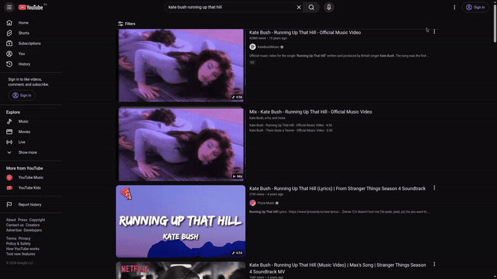

# tg-media-bot

[](https://github.com/antlis/tg-media-bot/actions/workflows/ci.yml)
[](LICENSE)

**🌐 [Сайт і огляд](https://antlis.is-a.dev/tg-media-bot/)**

[English](../README.md) · [Русский](README.ru.md) · [**Українська**](README.uk.md) · [Español](README.es.md)



Швидкий, легкий і надійний self-hosted Telegram-бот на **Rust** для завантаження відео та аудіо з соціальних мереж і відеохостингів з надсиланням прямо в чат Telegram.

Бот розроблений з акцентом на максимальну продуктивність та ощадне ставлення до ресурсів: споживає близько **4,5 МБ RAM** у простої, строго контролює дочірні процеси, захищає сервер від перевантажень і OOM, а також підтримує надсилання файлів розміром до **2 ГБ**.

---

## Можливості

- ⚡ **Висока швидкість і низьке споживання памʼяті** — ядро на Rust з асинхронним ран-таймом. Бот працює стабільно навіть на найдешевших VPS.
- 📦 **Файли до 2 ГБ** — вбудований локальний сервер Telegram Bot API обходить стандартне обмеження в 50 МБ, і важкі відео надходять у повній якості.
- 🎯 **Вибір якості** — інтерактивні кнопки при надсиланні посилання (максимум, 1080p, 720p, 480p, 360p або лише аудіо). Вибір можна зафіксувати командою `/quality`.
- 🚀 **Розумний кеш (миттєва видача)** — раніше завантажені медіа надсилаються миттєво за `file_id`, без повторного завантаження. Посилання нормалізуються (YouTube Shorts, пости X/Twitter тощо), і дублікати визначаються до старту завантаження.
- 🧹 **Чистий чат** — сервісні повідомлення («Завантажуємо…»), меню якості та початкове повідомлення з посиланням видаляються після успішного надсилання; посилання на джерело й назва лишаються в описі до файлу.
- 👥 **Справедлива черга** — особиста черга для кожного користувача, щоб один спамер не міг заблокувати решту.
- 🌐 **Багатомовність** — російська, українська, англійська та іспанська, автовизначення за клієнтом Telegram і перемикання через `/lang`.
- 🛡️ **Безпека** — білий список користувачів (`ALLOWED_USERS`), захист від SSRF (запити до локальних мереж і `localhost` блокуються).

---

## Підтримувані сайти

Завдяки рушію `yt-dlp` бот підтримує **1000+ сервісів**, зокрема:

- **YouTube** (відео, Shorts, плейлісти, YouTube Music)
- **TikTok** (відео і звук)
- **Instagram** (Reels, публікації, сторіс)
- **X (Twitter)** (відео та GIF)
- **Reddit** (відео зі звуком)
- **VK і Rutube**
- **Twitch** (кліпи і записи стримів)
- **Vimeo, SoundCloud, Pinterest** та багато інших

*Якщо сайт не підтримується yt-dlp, бот розширюється зовнішніми плагінами.*

---

## Швидкий старт на VPS (Docker)

Підійде будь-який сервер з Linux (Ubuntu / Debian).

### Встановлення в 5 кроків

1. **Підключіться до сервера по SSH:**
   ```bash
   ssh root@ip.вашого.сервера
   ```

2. **Встановіть Docker** (якщо ще не встановлений):
   ```bash
   curl -fsSL https://get.docker.com | sh
   ```

3. **Створіть каталог бота і завантажте конфіги:**
   ```bash
   mkdir -p tg-media-bot && cd tg-media-bot
   curl -fSL https://raw.githubusercontent.com/antlis/tg-media-bot/master/docker-compose.yml -o docker-compose.yml
   curl -fSL https://raw.githubusercontent.com/antlis/tg-media-bot/master/.env.example -o .env
   ```

4. **Заповніть `.env`:**
   ```bash
   nano .env
   ```
   Мінімально необхідні параметри:
   - `BOT_TOKEN` — токен бота від [@BotFather](https://t.me/BotFather).
   - `ALLOWED_USERS` — ваші ID в Telegram через кому (дізнатися в [@userinfobot](https://t.me/userinfobot)), щоб ботом користувалися лише ви та ваші друзі. Залиште порожнім — доступ відкритий усім.
   - `TELEGRAM_API_ID` і `TELEGRAM_API_HASH` — з [my.telegram.org/apps](https://my.telegram.org/apps). Потрібні для надсилання файлів до **2 ГБ** через локальний Bot API.

   > 💡 **Спрощений запуск без API ID/Hash (ліміт файлів 50 МБ):**
   > Якщо файли більше 50 МБ не потрібні, видаліть з `docker-compose.yml` сервіс `telegram-bot-api` і рядки `API_SERVER_URL` / `LOCAL_API_SHARED_FILES`. Тоді знадобляться лише `BOT_TOKEN` і `ALLOWED_USERS`.

5. **Запустіть бота:**
   ```bash
   docker compose up -d
   docker compose logs -f bot
   ```

### Альтернативні способи запуску

<details>
<summary><b>Локальна збірка з вихідників (Docker)</b></summary>

```bash
git clone https://github.com/antlis/tg-media-bot.git
cd tg-media-bot
cp .env.example .env
nano .env
docker compose up -d --build
docker compose logs -f bot
```
</details>

<details>
<summary><b>Запуск без Docker (systemd)</b></summary>

Потрібні `yt-dlp`, `ffmpeg`, `ffprobe` у `PATH`, а також `deno` для YouTube:

```bash
cargo build --release
sudo install -m755 target/release/tg-media-bot /usr/local/bin/
sudo install -Dm600 .env /etc/tg-media-bot/env
sudo cp packaging/tg-media-bot.service /etc/systemd/system/
sudo systemctl daemon-reload && sudo systemctl enable --now tg-media-bot
```
</details>

<details>
<summary><b>Встановлення через Nix</b></summary>

```bash
nix run github:antlis/tg-media-bot        # BOT_TOKEN тощо беруться з середовища
nix develop                              # dev-середовище: cargo + yt-dlp + ffmpeg + deno
```

Для home-manager імпортуйте `homeManagerModules.default` і увімкніть
`services.tg-media-bot` — бот запускається як користувацький сервіс, зберігає
стан у `~/.local/state/tg-media-bot` і читає `BOT_TOKEN` з
`environmentFile` (додаткові змінні — у `settings`). Не запускайте
Nix-бота і Docker-контейнер `bot` на одному токені одночасно — вони будуть
поллити один і той самий токен.
</details>

---

## Оновлення бота

При запуску через **Docker Compose** (стандартний спосіб):

```bash
cd tg-media-bot
docker compose pull && docker compose up -d
```

> *Примітка: рушій `yt-dlp` всередині контейнера також оновлюється автоматично раз на добу (коли немає активних завантажень).*

<details>
<summary><b>При встановленні з вихідників</b></summary>

**Docker (локальна збірка):**
```bash
cd tg-media-bot
git pull
docker compose up -d --build
```

**systemd:**
```bash
cd tg-media-bot
git pull
cargo build --release
sudo install -m755 target/release/tg-media-bot /usr/local/bin/
sudo systemctl restart tg-media-bot
```

**Nix:**
```bash
nix run github:antlis/tg-media-bot   # flakes фіксують nixpkgs; `nix flake update` їх оновлює
```
</details>

---

## Команди бота

| Команда | Опис |
|---|---|
| *посилання на медіа* | Бот запропонує вибрати якість і додасть задачу в чергу |
| `/start`, `/lang` | Вибір мови інтерфейсу (RU, UK, EN, ES) |
| `/help` | Довідка про можливості та поточні ліміти сервера |
| `/quality` | Зафіксувати якість за замовчуванням (або повернути запит на кожне повідомлення) |
| `/formats <посилання>` | Запросити вибір якості примусово (навіть якщо збережена якість за замовчуванням) |
| `/status` | Стан вашої черги та ID активних завантажень |
| `/cancel [id]` / `/cancel all` | Скасувати конкретне завантаження або всю свою чергу |
| `/clear [n]` | Видалити останні `n` повідомлень бота в чаті (за замовчуванням 100) |
| `/minimal on\|off` | Мінімалістичний режим (без статусів прогресу і детальних підписів) |
| `/topic lock\|unlock\|status` | Привʼязати роботу бота до конкретної теми супергрупи (форуму) |
| `/stats`, `/admin` | Моніторинг споживання CPU, памʼяті, диска та черг *(лише для адмінів)* |
| `/cleancache` | Примусове очищення кешу збережених `file_id` *(лише для адмінів)* |
| `/broadcast <текст>` | Розсилка системного повідомлення по всіх активних чатах *(лише для адмінів)* |

### Робота в групах

Коли дозволений користувач (`ALLOWED_USERS`) пише боту в групі, група активується, і ботом можуть користуватися всі її учасники. Щоб бот реагував на звичайні посилання без `@`-згадування, вимкніть **Group Privacy** у налаштуваннях бота у [@BotFather](https://t.me/BotFather).

---

## Основні параметри конфігурації (`.env`)

Детальні коментарі до всіх опцій — у файлі [.env.example](../.env.example).

| Змінна | За замовчуванням | Опис |
|---|---|---|
| `BOT_TOKEN` | — | Токен Telegram-бота |
| `ALLOWED_USERS` | — | ID користувачів з доступом (через кому) |
| `ADMIN_USERS` | — | ID адміністраторів бота (статистика, розсилки) |
| `MAX_PARALLEL_DOWNLOADS` | `1` | Кількість одночасних завантажень на весь бот |
| `USER_QUEUE_SIZE` | `100` | Максимальний розмір персональної черги користувача |
| `RATE_LIMIT_PER_USER` | `1` | Скільки посилань одного користувача завантажуються паралельно |
| `MAX_QUEUE_SIZE` | `1000` | Максимальний розмір спільної черги бота |
| `MAX_FILE_SIZE_MB` | ліміт API | Максимальний розмір файлу (якість підбирається під ліміт) |
| `MAX_DURATION_MIN` | `180` | Максимальна тривалість відео в хвилинах (0 — без ліміту) |
| `MAX_HEIGHT` | `1080` | Обмеження максимальної висоти відео (1080p, 720p тощо) |
| `MIN_FREE_DISK_MB` | `300` | Мінімальний залишок вільного диска для старту завантаження |
| `CHILD_NICE` | `10` | Пріоритет процесів `yt-dlp`/`ffmpeg` (0 — звичайний, 19 — мінімальний) |
| `BLOCK_PRIVATE_URLS` | `true` | Блокувати посилання на локальні мережі та `localhost` |
| `PROXY_URL` | — | Проксі для обходу регіональних обмежень (SOCKS5 / HTTP) |

---

## Авторизація та Cookies

Для завантаження контенту з закритих акаунтів або сервісів, що потребують авторизації (наприклад, Instagram або 18+ роліки на YouTube):

1. Експортуйте cookies у форматі Netscape (`cookies.txt`) за допомогою розширення браузера (наприклад, *Get cookies.txt LOCALLY*).
2. Покладіть файл у `./cookies/cookies.txt` поруч з `docker-compose.yml`.
3. Контейнер автоматично підхопить файл при наступному завантаженні.

---

## Плагіни для нестандартних сайтів

Якщо потрібен сайт, який не підтримується `yt-dlp`, додайте виконуваний скрипт у каталог `./plugins`:

- Плагін може бути написаний будь-якою мовою (Python, Bash, Node.js, Go тощо).
- Він отримує посилання першим аргументом командного рядка і виводить пряме посилання на потік або JSON із заголовками.
- Приклад: [examples/plugin-example.py](../examples/plugin-example.py).

---

## Тестування та діагностика

Можна протестувати вилучення і завантаження прямо в консолі контейнера, без Telegram:

```bash
docker compose run --rm bot fetch "https://youtu.be/..."        # відео
docker compose run --rm bot fetch "https://youtu.be/..." audio   # аудіо
docker compose run --rm bot fetch "https://youtu.be/..." 480     # обмеження роздільної здатності
```

---

## Ліцензія

Проект розповсюджується за ліцензією [MIT](../LICENSE).